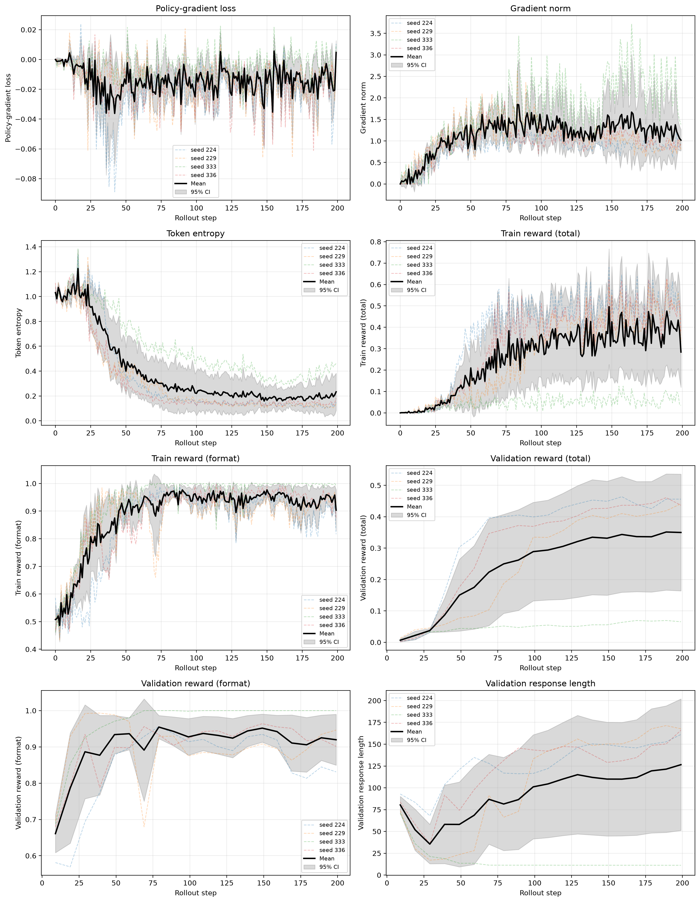
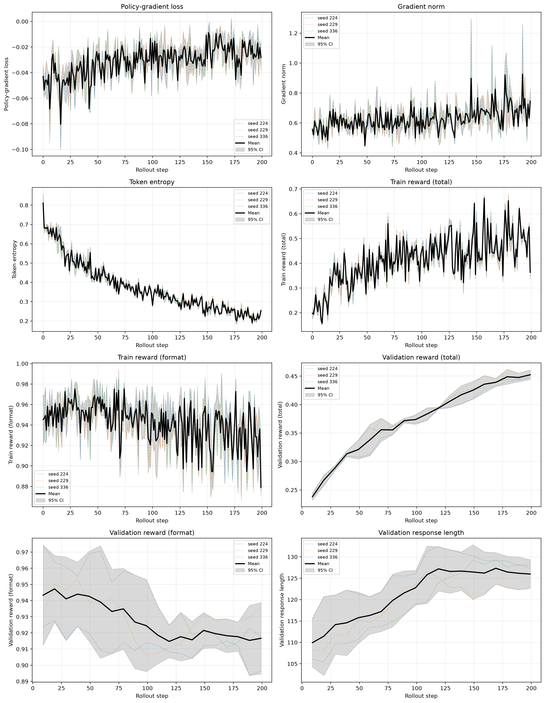
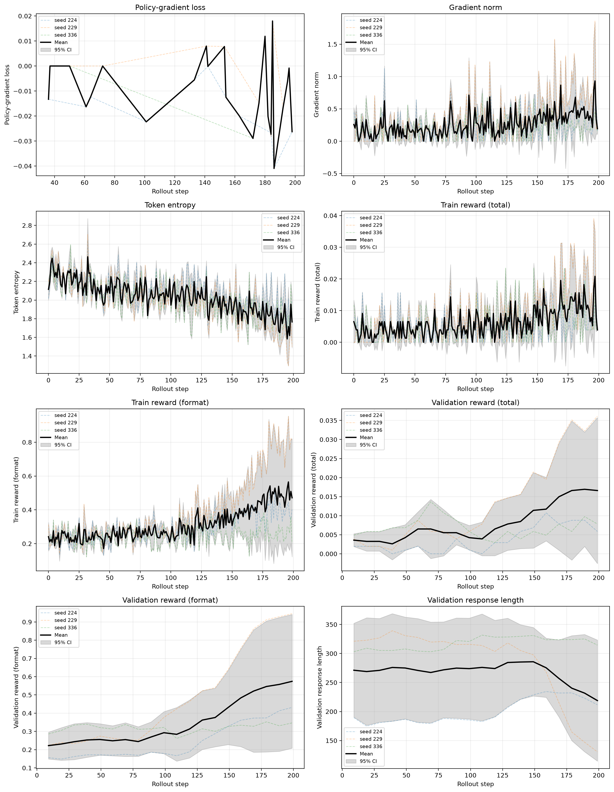
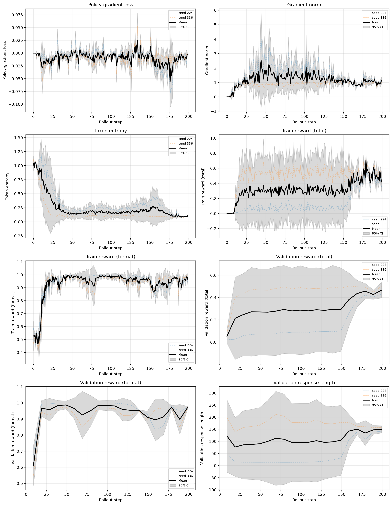
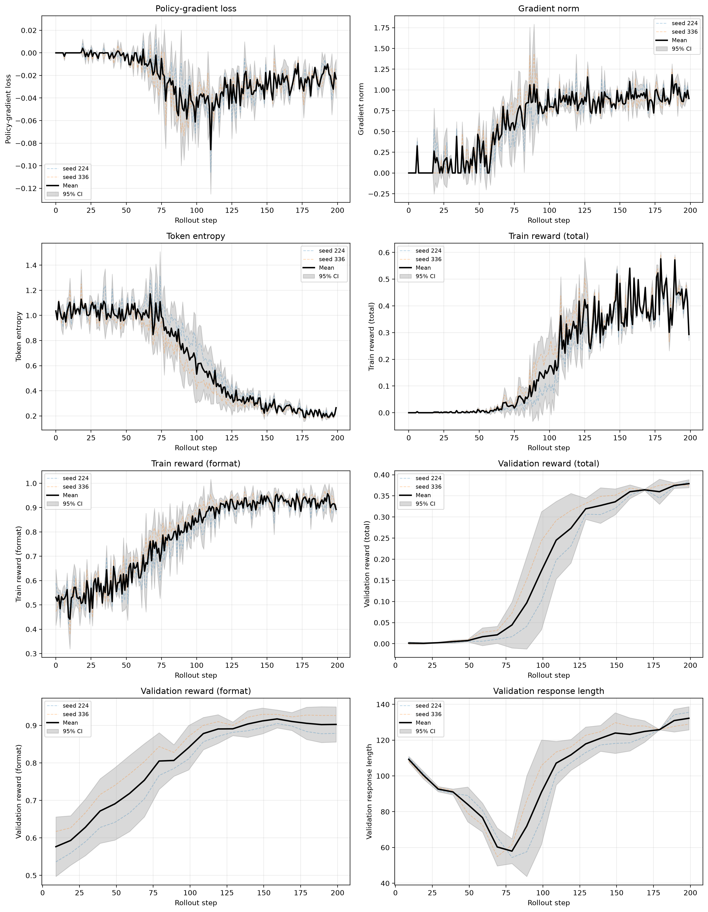

# CS336 Spring 2026 Assignment 5: Alignment

## Standard On-policy GRPO Exp Results

Default Learning Rate + r1_zero prompt with 4 seeds

Default Learning Rate + three shot prompt with 3 seeds

Default Learning Rate + question_only prompt with 3 seeds

Higher Learning Rate + r1_zero prompt

Lower Learning Rate + r1_zero prompt
